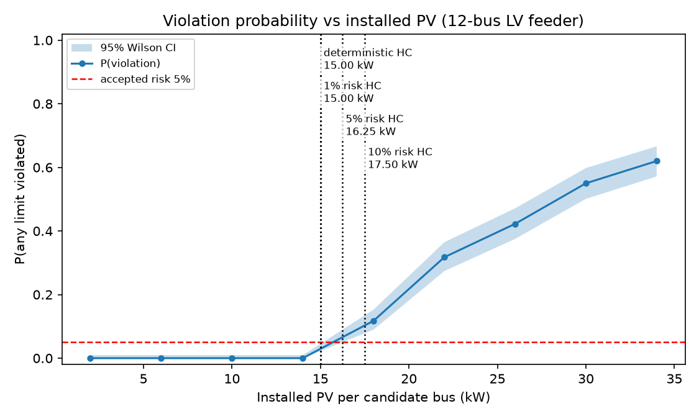
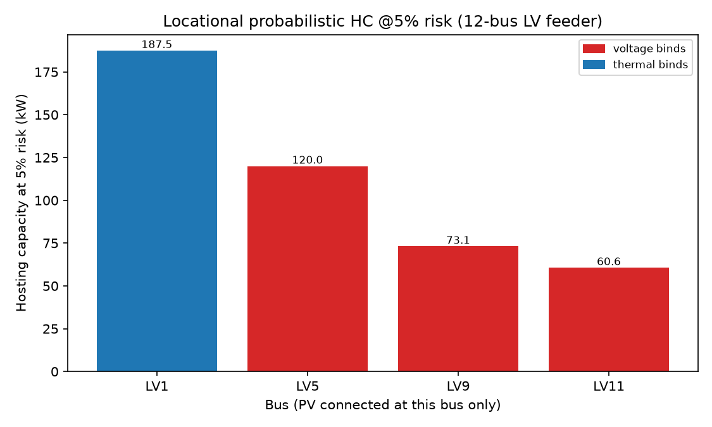

# pvhost-prob

**Probabilistic (stochastic) PV hosting capacity for distribution feeders, built on [pandapower](https://www.pandapower.org/).**

## Results at a glance

Built-in 12-bus 0.4 kV LV feeder, 400 correlated PV scenarios + load uncertainty:


*The exceedance curve: deterministic screening stops at 15.00 kW/bus (worst-case snapshot). Name an explicit risk and the feeder takes more — 10%-risk HC is 17.50 kW/bus, +16.7%.*


*Each bus on its own at 5% risk: LV1 next to the transformer hosts 187.5 kW before the cable rating binds; LV11 at the far end only 60.6 kW before overvoltage binds. The map a DSO actually needs for connection offers.*

Deterministic hosting capacity answers "how much PV fits under the worst-case snapshot". Planners don't live in the worst case — they live in risk. EPRI's stochastic hosting-capacity methodology (2012) made this point a decade ago: sample random PV deployments, report the *minimum and maximum* hosting capacity, and let the planner pick a risk level. Recent work keeps pushing the same direction — Monte Carlo HC with OpenDSS (Masic et al., *STET* 2025), optimization-based HC checked by 144k Monte Carlo simulations (*Electricity* 2026), Monte Carlo EV hosting capacity with explicit concurrency modelling (CIRED 2026).

What's missing is a packaged, tested, pandapower-native tool that turns this into a one-command workflow: correlated scenarios, exceedance curves, and *locational* probabilistic hosting capacity with binding-limit diagnostics. `pvhost-prob` is that tool. It complements deterministic screeners (such as [pvhostcap](https://github.com/chenyi6758-source/pvhostcap)): run the deterministic bisection for the conservative bound, then the probabilistic one for the risk-priced answer.

## Method

**Correlated PV scenarios** (`pvhostprob/scenarios.py`). One cloud shades the whole street, so sampling each bus independently understates coincident high-output events — exactly the events that drive overvoltage. Each bus's capacity factor is marginally Beta-distributed (the standard choice for [0, 1]-bounded irradiance-like quantities); dependence across buses comes from a Gaussian copula with tunable spatial correlation (default 0.85). Optional lognormal load uncertainty. All draws are seeded and reproducible.

**Monte Carlo engine** (`pvhostprob/simulate.py`). Per scenario: set each candidate bus's injection to `PV_kW × capacity_factor`, jitter the loads, run a full AC power flow, record worst bus voltage and worst line loading. A scenario violates if any bus exceeds `vm_max` (default 1.05 p.u.) or any line exceeds its rating. Non-converged scenarios count as violations (conservative) and are reported via `n_failed`.

**Estimators** (`pvhostprob/hc.py`). Violation probability is monotone non-decreasing in installed PV, so plain bisection converges. Functions: `deterministic_hc` (worst-case snapshot HC — conservative baseline), `probabilistic_hc` (largest uniform kW/bus with P(violation) ≤ risk, plus Wilson 95% CI), `locational_probabilistic_hc` (per-bus HC at risk with binding-limit diagnosis), `exceedance_curve` (P(violation) vs installed PV).

## Quickstart

```bash
pip install -e ".[test]"
python examples/quickstart.py   # ~8 min: 400 scenarios, full workflow
pytest -q                       # 30 tests
```

```python
from pvhostprob import (build_lv_feeder, correlated_capacity_factors,
                        probabilistic_hc, locational_probabilistic_hc)

net = build_lv_feeder(n_buses=12)
buses = [2, 4, 6, 8, 10, 11]
cf = correlated_capacity_factors(400, len(buses), corr=0.85, seed=0)

r = probabilistic_hc(net, buses, cf, risk=0.05)
print(f"HC @5% risk: {r['hc_kw_per_bus']:.1f} kW/bus")

loc = locational_probabilistic_hc(net, [1, 5, 9, 11], cf[:, [0]], risk=0.05)
print(loc[["bus_name", "hc_kw", "binding"]].to_string(index=False))
```

## Example results

12-bus LV feeder, 6 candidate buses, 400 scenarios (corr = 0.85), ±10% load uncertainty, `vm_max` = 1.05 p.u.:

Deterministic (worst-case) HC: 15.00 kW/bus (90.0 kW total). Probabilistic HC @ 1% risk: 15.00 kW/bus (+0.0%). @ 5% risk: 16.25 kW/bus (+8.3%). @ 10% risk: 17.50 kW/bus (+16.7%). Locational HC @ 5%: LV1 (at substation) 187.5 kW — thermal binds; LV5 120.0 kW, LV9 73.1 kW, LV11 (far end) 60.6 kW — voltage binds.

The risk ladder is smooth and monotone: as the accepted risk goes 1% → 5% → 10%, the answer moves 15.00 → 16.25 → 17.50 kW/bus — the planner literally prices risk in kW. The binding limit *moves* along the feeder: next to the transformer the cable rating binds first; at the far end it's overvoltage.

## Use your own network

Any pandapower net works — pass bus indices into the estimators:

```python
import pandapower as pp
net = pp.create_empty_network()
# ... your feeder ...
probabilistic_hc(net, pv_buses=[3, 7, 12], cf=cf, risk=0.05)
```

## References

- EPRI, stochastic hosting-capacity methodology (2012) — minimum/maximum HC from random-deployment Monte Carlo.
- Masic et al., "Hosting capacity in smart distribution systems using OpenDSS tool and Monte Carlo-based methodology", *Science and Technology for Energy Transition* 80 (2025).
- "Enhanced Optimization-Based PV Hosting Capacity Method for Improved Planning of Real Distribution Networks", *Electricity* 7(1):12 (2026).
- ULiège, "Electric vehicle hosting capacity in LV networks" (CIRED 2026 preprint).
- Bollen & Hassan, "Hosting Capacity of the Power Grid for Renewable Electricity Production and New Large Consumption Equipment", *Energies* 10(9):1325 (2017).
- Thurner et al., "pandapower — An Open-Source Python Tool for Convenient Modeling, Analysis and Optimization of Electric Power Systems", *IEEE Trans. Power Syst.* 33 (2018).

## License

BSD-3-Clause. See [LICENSE](LICENSE).
